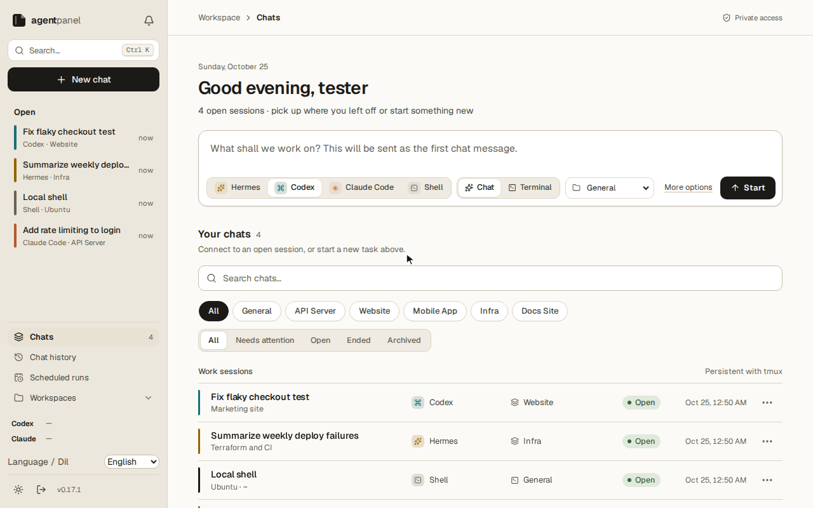
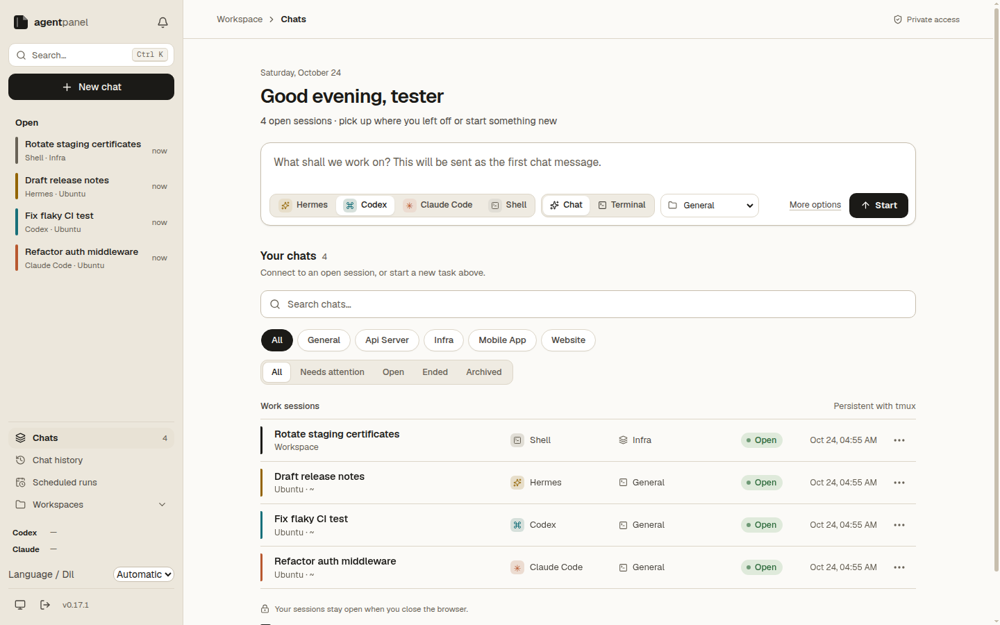
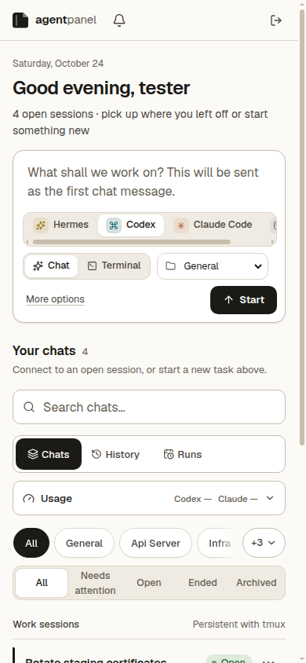

# Agent Panel

[](https://github.com/Pheidiase/agent-panel/actions/workflows/ci.yml) [](LICENSE)

Agent Panel is a self-hosted web interface for managing Claude Code, Codex, Hermes and shell sessions on your own Linux machine.

[Türkçe](README.tr.md) · [Security](SECURITY.md) · [Contributing](CONTRIBUTING.md)

> [!CAUTION]
> **THIS PANEL GIVES BROWSER USERS SHELL ACCESS TO YOUR MACHINE.**
> Anyone who can sign in can run commands with the Panel user's permissions and access that user's files and agent accounts. Keep it bound to loopback (`127.0.0.1`); do not expose it on `0.0.0.0` or `::`. Use a strong, unique password. Remote access must go through an HTTPS reverse proxy or tunnel, ideally behind an access layer (see [Exposing Agent Panel to the internet](#exposing-agent-panel-to-the-internet)). This is a single-owner tool, not a shared hosting service or a sandbox for untrusted code.

## Demo



## Screenshots





## Features

- Persistent tmux terminal sessions for installed Claude Code, Codex, Hermes and shell executables; restarting the web process leaves terminal sessions running.
- Live terminal and structured conversation views for supported agent protocols, with tool activity and reconnect support.
- Local conversation history, search, resume and deletion controls; a file-change/diff panel.
- Project discovery with optional metadata, session naming and project visibility preferences.
- Usage/quota views based on available local data: Codex rollout rate limits and an optional Claude usage snapshot. Availability and freshness depend on the agent; this is not a billing API.
- A read-only Hermes scheduled-run view when local run data is available.
- Responsive desktop/mobile layout, light/dark themes and English/Turkish UI.
- Local single-owner password authentication; an optional existing portal SSO integration. Other portal users cannot access the Panel.

## Requirements

- Linux or WSL2. For systemd on WSL2, enable systemd separately if needed.
- Node.js matching `package.json`: **`^22.23.4 || ^24.22.1 || ^26.12.1`**, and npm.
- `git`, `tmux`, Python 3, and the native build toolchain required by `node-pty` (C/C++ compiler and make).
- At least one agent CLI (Claude Code, Codex or Hermes), installed and authenticated separately, for agent features. Shell sessions can be used without an agent CLI.

On Debian/Ubuntu, prerequisite packages include `git tmux python3 build-essential`. Install a supported Node.js version with [nvm](https://github.com/nvm-sh/nvm) or from [nodejs.org](https://nodejs.org/); distribution packages may be too old. Panel does not install agent CLIs, sign in to providers or manage their credentials.

## Quick start

Replace `<repository-url>` with this repository's clone URL:

```sh
git clone <repository-url> agent-panel
cd agent-panel
npm ci
npm run build
npm run setup
npm run set-password
npm start
```

Open **http://127.0.0.1:4317**. The first password command prompts for the owner's username and a hidden password (12–200 characters). To specify the username explicitly, use `npm run set-password -- --owner --rename owner`. Run the same command later to change the password; do not put passwords in command arguments or environment variables.

In a terminal, enter the password only after each hidden prompt appears; pending input is discarded before each prompt, and confirmation is required. For automation, non-TTY stdin accepts exactly one password line (optional final newline), without prompts, confirmation or echo. Supply it through a trusted pipe or redirected private file; the supplying program must also avoid logging it. First setup with non-TTY stdin requires `--owner --rename <username>`.

Setup checks prerequisites and creates a private state directory (`0700`), `agents.json` and local `auth.json` (`0600`), preserving existing file contents. It does not generate a password, configure a tunnel or activate services. Missing agent CLIs appear as unavailable. Restart the web process after installing or changing a CLI.

## Troubleshooting

If `node-pty` cannot load after installation, npm 11 may require approval for its installation script. In the Panel directory, run:

```sh
npm install-scripts approve node-pty
npm rebuild node-pty
```

If a native build is needed, install a C/C++ compiler, make and Python 3 first. On Debian/Ubuntu these are provided by `build-essential` and `python3`, then retry the rebuild.

## Configuration

State defaults to `<project>/var`; keep it out of version control and public exports. JSON settings are read at startup, so restart the web process after changing them. Environment variables override the matching file settings. Examples live in [examples/](examples/); review them before copying. The empty `agents.json` example uses PATH discovery; setup normally writes the discovered absolute executable paths. `settings.json` and `projects.json` are optional and are not generated by setup.

| Setting | Default | Purpose |
| --- | --- | --- |
| `PANEL_STATE_DIR` | `<project>/var` | Private settings and runtime data. |
| `PANEL_WORKSPACE` / `settings.json.workspace` | Parent of the Panel directory | Discover project directories directly below this path. Relative paths resolve from the Panel root. The example uses `../projects`; create that directory or choose an existing one. |
| `PANEL_HOST` / `settings.json.host` | `127.0.0.1` | Listen IP address; keep loopback for remote proxy/tunnel access too. |
| `PANEL_PORT` / `settings.json.port` | `4317` | TCP port, 1–65535. |
| `settings.json.homeUrl` | Unset (links hidden) | Optional HTTP(S) navigation link; does not grant Host/Origin access. Remove the example URL if not needed. |
| `projects.json` in state | `config/projects.json` | Full replacement metadata array; directory discovery still runs. Preserve the `general` record to keep the home-directory entry. |
| `agents.json` in state | PATH discovery | Map `claude`, `codex`, `hermes`, `shell` to executable paths or command names; missing keys use PATH (`bash` for shell). No command arguments. |
| `auth.json.mode` | `local` | `local` or `portal`; an existing file must explicitly include `mode`. No automatic fallback between modes. |
| `auth.json.trustProxyHeader` | `false` | Trust one valid `CF-Connecting-IP` value only from a loopback socket. Enable only when a trusted local proxy strips incoming copies and writes the real client IP. Other forwarded headers are ignored. |
| `named-origins.json` in state | No remote origins | `{ "origins": ["https://panel.example.com"] }`; up to eight exact HTTPS origins, with no path, trailing slash or explicit port. |
| `public-origin.json` in state | Unset | Legacy quick-tunnel support: `{ "origin": "https://example.trycloudflare.com" }`. Only that exact quick-tunnel origin is accepted. |
| `PANEL_TMUX_BINARY` / `PANEL_PYTHON_BINARY` | PATH `tmux` / `python3` | Required runtime tools. |
| `PANEL_CLAUDE_BINARY` / `PANEL_CODEX_BINARY` | Agent config, then PATH | Override Claude Code / Codex executables. |
| `PANEL_ACP_BINARY` / `PANEL_SHELL_BINARY` | Agent config, then PATH | Override Hermes / shell executables. |
| `PANEL_TMUX_SOCKET` | `<state>/tmux.sock` | Panel-owned tmux socket. |
| `PANEL_SYSTEMCTL_BINARY` | PATH `systemctl` | Prerequisite check for `setup --systemd`; setup does not run it. |
| `PATH` | Process environment | Executable discovery. An invalid explicit override disables that agent; it does not silently use a different executable. |
| `XDG_CONFIG_HOME` | `~/.config` | User unit directory base for `setup --systemd`. |

Keep state private (`0700` directory, `0600` credentials). Do not copy `owner.json`, session data, audit logs or agent authentication into examples. Local mode uses one Node web process, not a multi-worker deployment.

### Authentication modes

**Local** is the standalone default. `npm run set-password` creates or updates the one owner account; the browser cannot bootstrap an account. Password changes revoke prior sessions. Authentication state is private and must be backed up securely.

**Portal** is an optional integration for installations that already operate the compatible portal protocol; the portal server is not bundled. Select it explicitly with `{ "mode": "portal", "trustProxyHeader": false }` in state `auth.json`, and provision private `auth-client.json` through your portal administration. Its fields are `app` (`panel`), `key` (shared secret), `portalInternal` (loopback HTTP service), `portalOrigin` and `publicOrigin` (exact origins). The portal owns identity, passwords and permissions. Panel remains **owner-only**: project permissions never grant another portal user access. An old `auth-client.json` alone does not select portal mode. Setup preserves an existing `auth.json`; set the correct mode before upgrading an existing installation.

## Remote access

Keep Panel on `127.0.0.1:4317`. Put an HTTPS reverse proxy or tunnel in front of it, preserving the public Host and Origin and supporting WebSocket upgrades. Add the exact public origin to state `named-origins.json` and restart the web process. Changing the listen address or `homeUrl` does not add an allowed origin. Non-loopback sessions require secure cookies and HTTPS.

For example, create and operate a Cloudflare Tunnel using Cloudflare's own instructions, map your hostname (such as `panel.example.com`) to `http://127.0.0.1:4317`, and allow `https://panel.example.com` in `named-origins.json`. Keep tunnel credentials outside the repository. Panel does not install or manage the tunnel. Leave `trustProxyHeader` false unless the trusted loopback proxy guarantees the header handling described above; with false, proxied clients share the proxy's IP rate limit.

## Exposing Agent Panel to the internet

Read this before making the Panel reachable from outside your machine.

**Whoever signs in gets the full power of your user account.** The Shell agent is a real terminal, and the coding agents run commands on your behalf. Treat the Panel password like an SSH private key: if it leaks, the machine is compromised.

- **Do not port-forward and do not bind `0.0.0.0` or `::`.** The default is `127.0.0.1`; keep it, and reach the Panel through a tunnel or proxy that connects to loopback.
- **Put an identity-aware layer in front, so attackers cannot even reach the login page.** Options, from simplest to most involved:
  - **Cloudflare Tunnel + Cloudflare Access.** The tunnel makes an outbound connection, so no inbound port is opened. Add an Access application for the hostname with a policy that allows only your email (one-time PIN) or your SSO identity. Follow Cloudflare's Zero Trust documentation; then add the exact `https://` origin to `named-origins.json`.
  - **A private network** such as Tailscale or WireGuard: the Panel is reachable only from your own devices. Run a reverse proxy on the private address, or use `tailscale serve`, so the browser still gets HTTPS (non-loopback sessions need secure cookies).
  - **An SSH tunnel** for occasional use: `ssh -L 4317:127.0.0.1:4317 you@your-server`, then open `http://127.0.0.1:4317` locally. Nothing is exposed.
- **An unguessable subdomain is not protection.** Public hostnames are discoverable through Certificate Transparency logs and DNS; scanners often probe new HTTPS names within minutes. Rely on an access layer, not on a hidden name.
- **Use a long, unique password.** The CLI requires 12–200 characters; use a password-manager-generated one that you use nowhere else. Failed logins are rate-limited per client IP and username, which slows guessing but does not replace an access layer. Behind a proxy, leave `trustProxyHeader` off unless the proxy meets the conditions in [Configuration](#configuration); otherwise all visitors share the proxy's IP budget.
- **There is no built-in two-factor authentication yet.** That is why the access layer above matters: it supplies the second factor.
- **Optionally switch the Shell agent off.** Set `"shell"` in `agents.json` (in the state directory) to a path that does not exist, for example `{ "shell": "/nonexistent" }`, and restart the web process; the Panel then shows Shell as unavailable and refuses to start shell sessions. If `PANEL_SHELL_BINARY` is set, it takes precedence, so unset it. This reduces exposure but does not make the Panel safe to expose: Claude Code, Codex and Hermes can still run commands on your machine.

Check the setup from an outside network (a phone on mobile data) before relying on it: you should see the access layer's sign-in, not the Panel's login page.

## Run with systemd

After building and setting a password:

```sh
npm run setup -- --systemd
```

This writes new `agent-panel-tmux.service` and `agent-panel-web.service` user units below `~/.config/systemd/user` (or `XDG_CONFIG_HOME`). It refuses to overwrite existing units and does not start or enable anything. Review the generated files, then activate them yourself:

```sh
systemctl --user daemon-reload
systemctl --user enable --now agent-panel-tmux.service agent-panel-web.service
```

Web and tmux are separate services. Restart only `agent-panel-web.service` to retain terminal sessions; stopping tmux terminates them. User-service availability after logout or reboot depends on your system's login/linger configuration. Do not run an additional `npm start` alongside the service on the same port/state.

## Development and tests

```sh
npm test
npm run build
node node_modules/vite/bin/vite.js --host 127.0.0.1
```

Vite serves the UI for development; normal authenticated operation uses the Node server and built assets. Tests use synthetic fixtures and must not send real model prompts or messages. Some integration tests need local subprocesses, tmux or loopback listeners; restricted sandboxes can prevent them from running. See [CONTRIBUTING.md](CONTRIBUTING.md).

## License

Agent Panel is released under the [MIT License](LICENSE).
